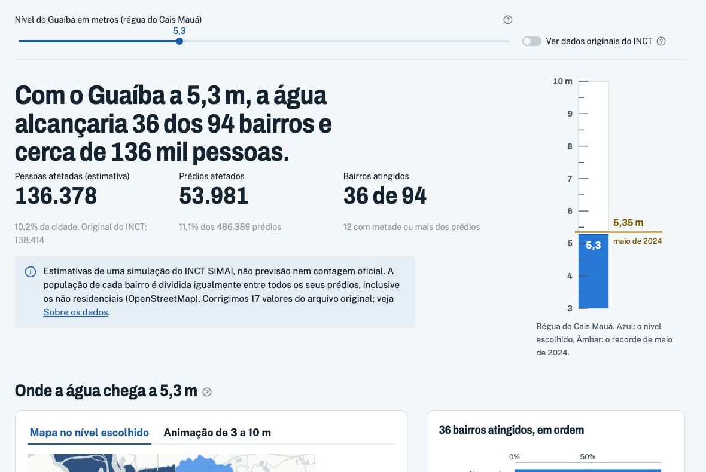
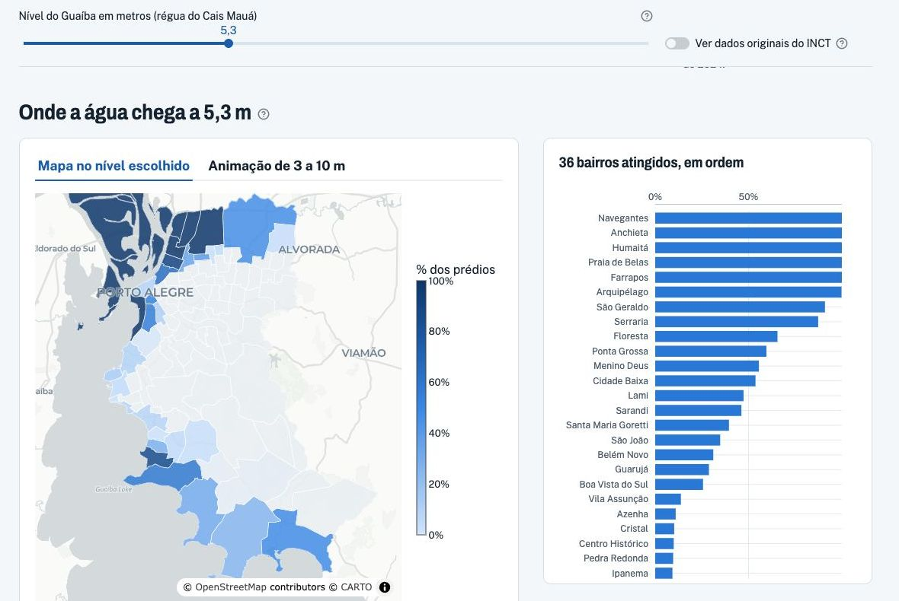
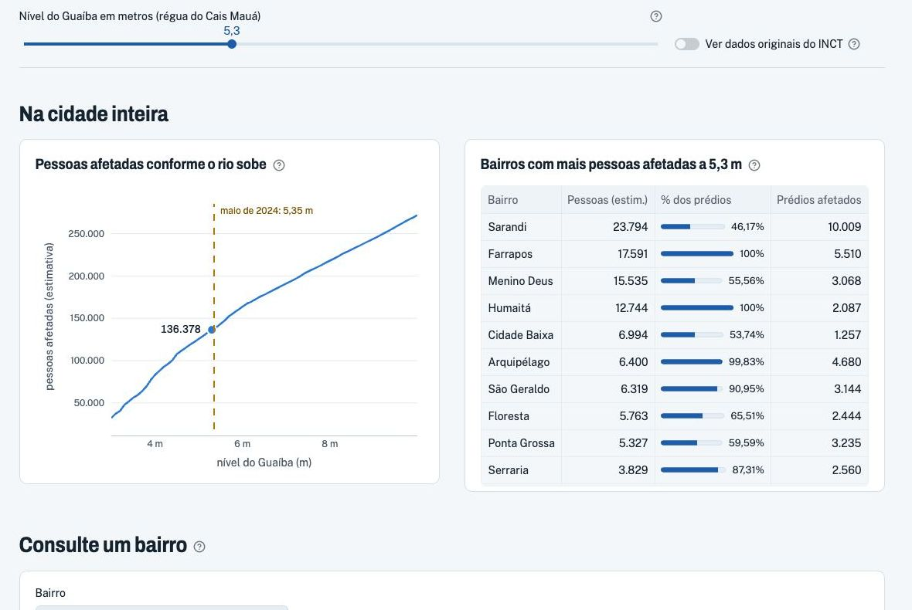
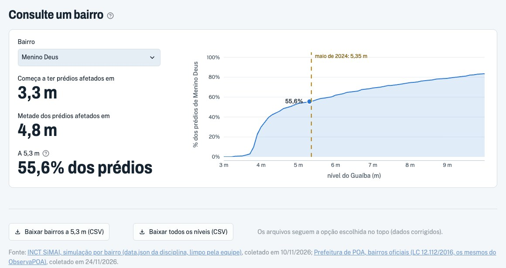
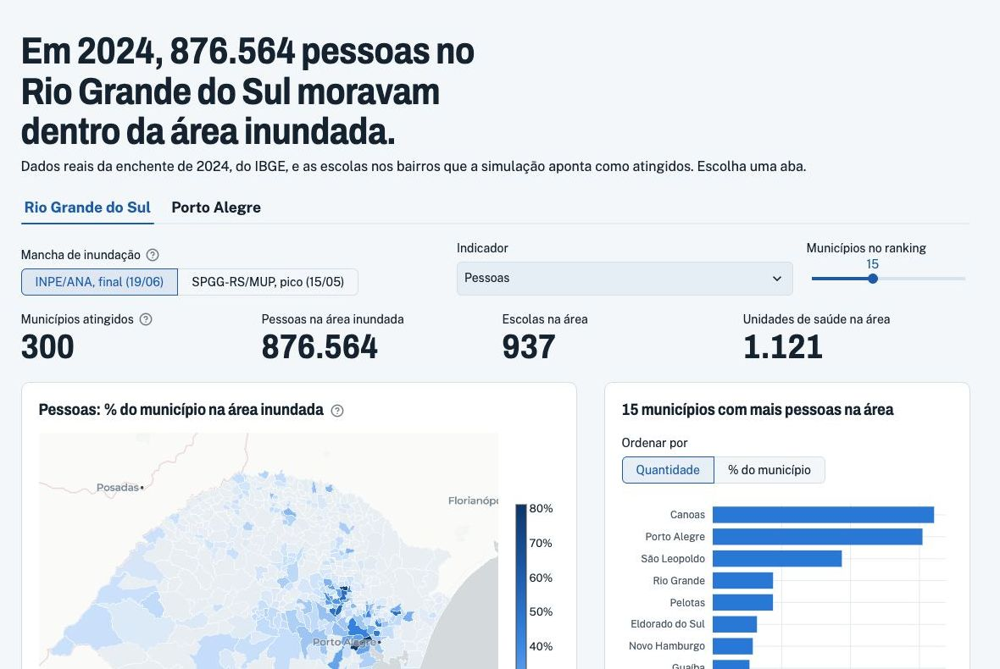
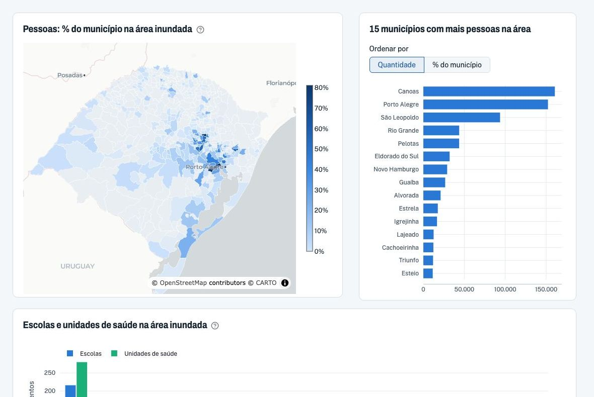
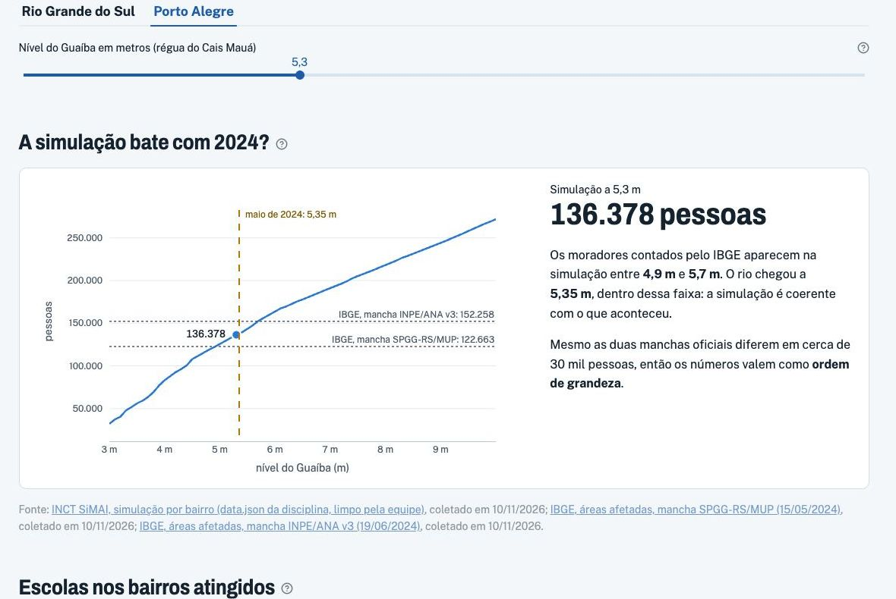
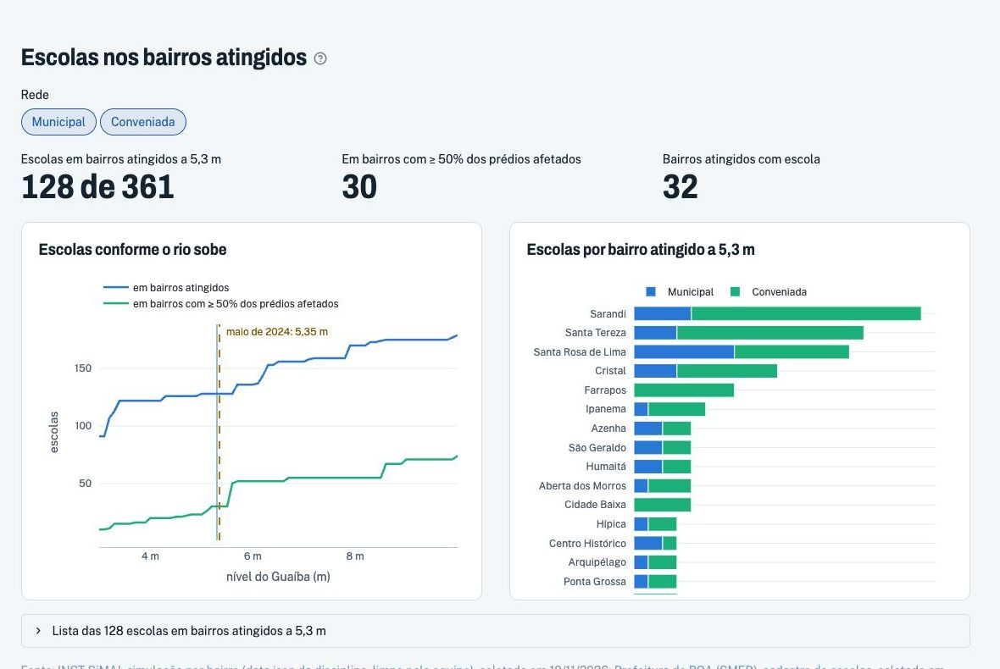
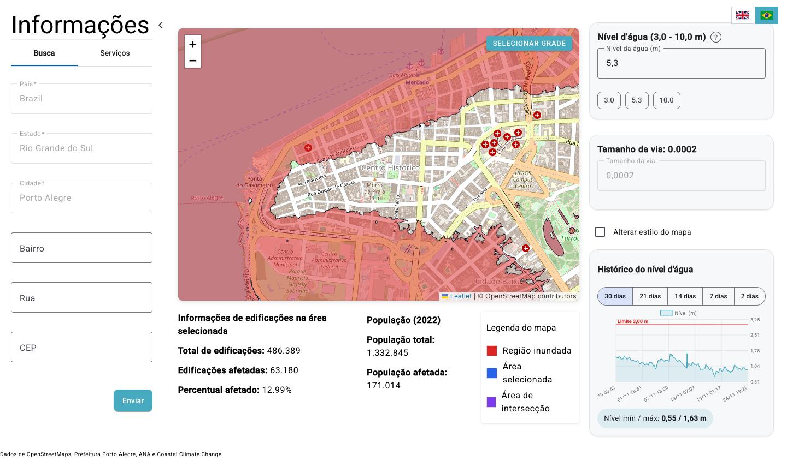

# Relatório do Dashboard: Fase 3 e versão final

Projeto Extensionista: Análise de Dados de Enchentes do INCT SiMAI

Coleta, Preparação e Análise de Dados (PUCRS), Profª Katherine Bianchini Esper de Vargas

Equipe: Pedro Ernesto, Ana Luiza Romanini, Enrico Pheula, Fransico Cassol, Pedro Fam

Dashboard: _(link do Streamlit Community Cloud, a preencher após o deploy)_

Repositório: <https://github.com/pedroSegabi/trabalhoColeta>

24/11/2026

---

## 1. Visão geral

O dashboard responde a duas perguntas, uma em cada tela. A Tela 1 usa a simulação do INCT SiMAI para mostrar quais bairros de Porto Alegre e quantas pessoas seriam afetados se o Guaíba chegasse a um determinado nível, entre 3,0 e 10,0 m. A Tela 2 usa dados oficiais da enchente de 2024 para verificar o que eles acrescentam à simulação.

O app foi feito em Python, com Streamlit e Plotly. As duas bibliotecas aparecem na aula de Visualização de Dados, na parte "Bibliotecas Python para Dashboards", e o enunciado sugere o Plotly e a publicação no Streamlit Community Cloud. O app só lê os arquivos gerados pelos scripts das fases anteriores, na pasta `dados/processados/`. Nenhum número foi digitado à mão.

| Arquivo | Função |
|---|---|
| `app/app.py` | Configura a página e a navegação entre as telas |
| `app/dados.py` | Leitura dos dados, formatação no padrão brasileiro, cores e partes comuns dos gráficos |
| `app/tela1.py` e `app/tela2.py` | As duas telas |
| `app/sobre.py` | Página com instruções de uso, limitações, correções, fontes, equipe e uso de IA |
| `tests/test_app.py` | Testes automáticos: as páginas abrem sem erro e os principais números conferem |

## 2. Tela 1: simulação por nível do rio

A Tela 1 mostra, para qualquer nível entre 3,0 e 10,0 m, até onde a água chega e quantas pessoas e prédios seriam afetados. Todos os números são estimativas da simulação, e a tela deixa isso escrito.

No topo fica o controle do nível, que vai de 3,0 a 10,0 m em passos de 0,1 m e continua visível quando a página rola. Ao mudar o nível, todos os elementos da tela são atualizados. O nível também vai para o endereço da página (por exemplo, `?nivel=6,5`), então quem recebe o link abre a tela no mesmo cenário.

O título da tela é uma frase com a resposta e muda com o nível: "Com o Guaíba a 5,3 m, a água alcançaria 36 dos 94 bairros e cerca de 136 mil pessoas". Abaixo dele há três indicadores: pessoas afetadas (com o percentual da cidade), prédios afetados (com o percentual do total) e bairros atingidos. Ao lado, uma régua de 3 a 10 m mostra o nível escolhido e a marca de 5,35 m, o recorde de maio de 2024. Logo abaixo dos indicadores, uma nota curta explica as limitações: os números são estimativas de uma simulação, a população de cada bairro é dividida igualmente entre os seus prédios e 17 valores do arquivo original foram corrigidos.

O mapa mostra o percentual de prédios afetados em cada bairro, na malha oficial de bairros da Prefeitura. Usamos uma escala de um só tom de azul, do claro ao escuro, porque o valor é contínuo. Com ele dá para ver que a orla, as ilhas e a zona norte são atingidas primeiro. Uma segunda aba anima o mapa de 3,0 a 10,0 m. Ao lado do mapa, as barras horizontais trazem os mesmos percentuais em ordem: comparar comprimentos é mais preciso do que comparar cores, e assim os nomes dos bairros ficam legíveis.

A curva mostra o total de pessoas afetadas na cidade conforme o nível sobe, com uma linha tracejada em 5,35 m e um ponto no nível escolhido. O ranking lista os 10 bairros com mais pessoas afetadas. Ele complementa as barras, porque um bairro grande e pouco alagado, como o Sarandi, pode ter mais pessoas afetadas do que um bairro pequeno e todo alagado.

Na consulta por bairro, o usuário escolhe um bairro e vê a partir de que nível ele começa a ser atingido, em que nível chega à metade dos prédios e a curva completa do bairro. Um botão no topo troca todos os números pelos valores originais do `data.json`, sem as nossas correções; a 5,3 m, por exemplo, as 136.378 pessoas passam a ser 138.414. Por fim, dois botões baixam os dados em CSV, só do nível escolhido ou de todos os níveis.

## 3. Tela 2: a enchente real de 2024

A Tela 2 compara a simulação com o que ficou embaixo d'água em 2024 e mostra o que havia nas áreas atingidas. Ela usa três bases externas: os dados do IBGE sobre pessoas, domicílios e estabelecimentos dentro de duas manchas oficiais de inundação, por município; a malha municipal do IBGE; e o cadastro de escolas da Prefeitura. A descrição completa das bases está em `relatorios/base_dados.pdf`. A tela tem duas abas, cada uma com os seus filtros.

Na aba Rio Grande do Sul, o usuário escolhe a mancha de inundação (INPE/ANA v3 ou SPGG-RS/MUP), o indicador (pessoas, domicílios, escolas, unidades de saúde ou estabelecimentos agropecuários) e quantos municípios aparecem no ranking. Mantivemos as duas manchas porque ambas são oficiais e dão resultados diferentes. O título resume o resultado da mancha escolhida, e quatro indicadores mostram os municípios com moradores na área inundada, as pessoas, as escolas e as unidades de saúde.

O mapa do RS mostra que parte de cada município ficou dentro da área inundada, em percentual. Em números absolutos só as cidades grandes apareceriam; com o percentual, municípios pequenos e muito atingidos ficam visíveis, como Muçum (75% da população) e Roca Sales (53%), no Vale do Taquari. As barras ao lado mostram os municípios mais atingidos, em quantidade ou em percentual, e um terceiro gráfico compara as escolas e as unidades de saúde dentro da área inundada em cada município.

A aba Porto Alegre usa o mesmo nível da Tela 1. O primeiro gráfico coloca a curva da simulação junto das duas contagens do IBGE para a cidade, 122.663 e 152.258 pessoas. A simulação chega a esses valores entre 4,9 e 5,7 m, e o rio chegou a 5,35 m em maio de 2024. A simulação, portanto, é coerente com o que aconteceu.

O segundo bloco cruza o cadastro de escolas com os bairros atingidos na simulação. Ele mostra quantas escolas municipais e conveniadas ficam em bairros atingidos em cada nível, quais são esses bairros e a lista das escolas, com filtro por rede. A 5,3 m são 128 das 361 escolas.

Embaixo de cada visualização, nas duas telas, uma legenda informa a fonte dos dados, com link e data de coleta. No fim da Tela 2 há uma tabela com todas as fontes. As legendas e a tabela são lidas do registro de downloads, em `dados/originais/coleta.json`.

## 4. Como usar

1. Abra o link do dashboard. A Tela 1 abre no nível 5,3 m, o mais próximo do recorde de maio de 2024.
2. Arraste o controle do nível ou use as setas do teclado. Os indicadores, o mapa, as barras, a curva e o ranking mudam juntos.
3. Passe o mouse sobre um bairro ou sobre uma barra para ver os números. Na aba de animação do mapa, aperte "Reproduzir".
4. Em "Consulte um bairro", escolha um bairro para ver a partir de que nível ele é atingido.
5. Ligue "Ver dados originais do INCT" para comparar com o arquivo sem correções. Os botões de download baixam os dados em CSV.
6. Na Tela 2, escolha a mancha e o indicador. A aba Porto Alegre usa o mesmo nível escolhido na Tela 1.
7. Para mostrar um cenário a alguém, copie o endereço da página, que guarda o nível.

## 5. Decisões de design

Antes de mexer no código, a equipe aprovou uma direção visual a partir de mocks. A ideia veio da régua do Cais Mauá, que a cidade inteira acompanhou em maio de 2024. Por isso a Tela 1 tem uma régua de 3 a 10 m ao lado do título, com a água no nível escolhido e uma marca em 5,35 m. Ela é o único elemento de destaque; o restante do painel é discreto.

A cor âmbar aparece só na marca de 5,35 m, na régua e na linha tracejada dos gráficos, para ter sempre o mesmo significado. Os dados usam azul, em escala de um só tom, e a segunda série dos gráficos (escolas conveniadas e unidades de saúde) usa verde-água. Não usamos vermelho. As cores continuam distinguíveis por pessoas com daltonismo, os gráficos com duas séries têm legenda e o contraste do texto passa de 4,5:1.

Evitamos o tom alarmista: os títulos são frases neutras, "pessoas afetadas" vem sempre acompanhado de "(estimativa)" e a nota de limitações é discreta. Os títulos e números usam a fonte Archivo, e o texto usa a Public Sans, uma fonte aberta feita para serviços públicos. Os números seguem o formato brasileiro (5,3 m; 136.378).

Cada gráfico fica em um bloco com título próprio, e as dicas de leitura ficam num ícone "?" ao lado do título, para não encher a tela de texto. Os filtros ficam perto do que controlam, cada gráfico tem um só eixo vertical e, no celular, as colunas ficam uma embaixo da outra, sem rolagem horizontal.

A tabela abaixo relaciona os critérios da aula de Visualização de Dados com o dashboard.

| Critério da aula | Como aparece no dashboard |
|---|---|
| Teste dos 30 segundos: o que está acontecendo, o que merece atenção, onde investigar | O título da Tela 1 já traz a resposta; a régua e o mapa mostram onde; o ranking e a consulta por bairro mostram onde investigar |
| Cada dashboard responde a uma pergunta clara, com uma tela para a pergunta inicial e outra para análises secundárias | A Tela 1 responde à pergunta do INCT; a Tela 2 traz as análises com as bases externas |
| Linha para evolução, barras para comparação, mapas para dados geográficos | Curvas por nível do rio; barras para bairros, municípios e escolas; mapas dos bairros e dos municípios. Sem pizza e sem 3D |
| Cores com significado e paleta consistente | Azul para os dados e âmbar só para a cota de 2024, nas duas telas |
| Poucas métricas, as que influenciam decisões | Três indicadores na Tela 1 e quatro na Tela 2 |
| Contexto temporal e comparações | Datas das manchas e da coleta; percentual da cidade e do município; comparação com o recorde de 2024 e com o IBGE |

## 6. Limitações

- É uma simulação, não uma previsão nem uma contagem. Ela considera só o nível do Guaíba; chuva local, falhas de comportas e diques e o tempo de cheia ficam de fora.
- O número de pessoas afetadas supõe que os moradores estão distribuídos igualmente entre todos os prédios do bairro, inclusive comércio e galpões.
- Os prédios vêm do OpenStreetMap, cuja cobertura varia entre bairros.
- O resultado é por bairro, não por rua ou prédio. Uma escola num bairro atingido não significa que a escola alagou.
- Os dados do IBGE são por município, então a comparação com a simulação é feita para Porto Alegre inteira. As duas manchas oficiais diferem em cerca de 30 mil pessoas na cidade.
- O cadastro de escolas cobre só a rede municipal e as escolas conveniadas da SMED. Escolas estaduais e particulares sem convênio não entram.
- Os números do `data.json` não batem com os da ferramenta online do INCT para o mesmo nível (seção 7).

## 7. Observações sobre a ferramenta atual do INCT

> Rascunho preparado a partir da navegação na ferramenta em 24/11/2026. A equipe deve conferir cada item antes da entrega.

A ferramenta atual tem busca por endereço e CEP, mapa detalhado por rua, seleção de uma área ("grade"), estimativa de rota de evacuação, serviços afetados (saúde, transporte) e o histórico do nível do Guaíba pela telemetria da ANA. Ela foi pensada para o caso individual, como "a minha rua alaga?". Encontramos os seguintes problemas e ausências:

1. Não há visão por bairro. A ferramenta não tem lista nem ranking de bairros atingidos, nem a curva da cidade conforme o nível. Para comparar bairros, é preciso pesquisar um por um. O nosso dashboard começa justamente por essa visão geral.
2. Os números diferem do `data.json` distribuído. Para a cidade inteira:

| Nível | Ferramenta online: edificações / pessoas | `data.json`: edificações / pessoas |
|---|---|---|
| 3,0 m | 25.736 / 68.298 | 15.264 / 34.605 |
| 5,3 m | 63.180 / 171.014 | 53.989 / 138.414 |
| 10,0 m | 100.161 / 274.296 | 101.211 / 274.993 |

   Nos níveis baixos, a ferramenta mostra quase o dobro de pessoas, o que sugere versões diferentes da simulação. Sugerimos ao INCT publicar o arquivo com número de versão e data e mostrar a versão na tela.

3. A conexão não é segura. O endereço `https://vhlab.com.br/INCT/floods/` redireciona para `http://`, e a API fica em `http://vhlab.lad.pucrs.br:5002`, também sem criptografia e numa porta incomum, que redes corporativas ou de visitantes costumam bloquear. Nesses casos a página abre, mas os dados não carregam.
4. O histórico do nível demora. Na nossa medição, a série da ANA levou cerca de 11,5 s para carregar, enquanto os dados do mapa vieram em menos de 1 s.
5. A página baixa cerca de 1,6 MB de JavaScript e CSS antes de mostrar qualquer dado.
6. Há detalhes de interface a corrigir. Os percentuais aparecem com ponto decimal ("12.99%") na versão em português, e o campo "Tamanho da via: 0.0002" não tem unidade nem explicação. O nível só pode ser digitado ou escolhido em três botões (3,0, 5,3 e 10,0), sem controle deslizante. A aba se chama "Flood" e a página está marcada como inglês (`lang="en"`), o que atrapalha leitores de tela. A área inundada é pintada de vermelho forte sobre o mapa.
7. Não encontramos aviso claro de limitações nem download dos dados na tela inicial (conferir).

A partir disso, incluímos no nosso dashboard a visão por bairro e pela cidade, a curva de população conforme o nível, o ranking, a consulta por bairro, o aviso de limitações sempre visível, a comparação com os dados de 2024, o download em CSV e o link que guarda o nível.

## 8. O que mudou desde a Fase 2

O wireframe da Fase 2 virou o app, com a mesma divisão em duas telas. Depois, o visual foi redesenhado a partir dos mocks aprovados pela equipe (seção 5). Em relação ao wireframe, acrescentamos o mapa dos bairros com a malha oficial, a animação, a consulta por bairro, a comparação entre dados originais e corrigidos, o download em CSV, o link que guarda o nível, o mapa do RS por município e as escolas por bairro e nível.

Para isso preparamos duas novas bases, com o script `scripts/preparar_prefeitura.py`. Na malha de bairros, os 94 nomes batem com os do INCT depois de dois ajustes de grafia, e o arquivo é idêntico aos "Bairros Oficiais" do ObservaPOA indicados no enunciado (mesmas 128 feições e mesma geometria). No cadastro de escolas, recuperamos 3 linhas que tinham campos a mais, em vez de descartá-las. O bairro de cada escola foi definido pela posição do ponto na malha oficial: em 55 escolas, o bairro declarado segue a divisão anterior à lei de 2016 (por exemplo, "Rubem Berta" para escolas que hoje ficam em Santa Rosa de Lima), e usar a posição deixa as escolas na mesma divisão de bairros do INCT. As 38 escolas sem coordenada usam o bairro declarado.

A coleta também passou a respeitar o `robots.txt` de cada site, incluindo o intervalo de 10 s pedido pelo portal de dados abertos da Prefeitura, e registra a URL e a data de cada arquivo em `dados/originais/coleta.json`.

## 9. Reprodutibilidade e testes

Os comandos para rodar tudo estão no `README.md`. Os scripts de dados terminam com verificações (`assert`): a malha precisa ter exatamente os 94 bairros do INCT, toda escola com coordenada precisa cair em algum bairro e todo município do IBGE precisa ter polígono no mapa. O comando `python -m pytest tests/` abre as três páginas e confere os números da Tela 1: 136.378 pessoas a 5,3 m nos dados corrigidos e 138.414 nos originais, e 274.993 pessoas e 54 bairros a 10 m.

## 10. Uso de ferramentas de IA

Usamos o Claude Code (Anthropic). Todas as tarefas abaixo foram solicitadas pela equipe ao Claude, e todo o resultado foi revisado pela equipe.

| Etapa | O que a equipe pediu ao Claude |
|---|---|
| Bases complementares | Verificar a disponibilidade da malha de bairros, do cadastro de escolas e da malha do RS em portais oficiais, e escrever o script de coleta e preparação (`preparar_prefeitura.py`, ajustes em `coletar_ibge.py`) |
| Dashboard | Escrever o código das telas a partir do wireframe e da lista de funcionalidades definida pela equipe |
| Design visual | Propor uma direção visual em mocks (a régua do Guaíba) e aplicá-la ao app depois da aprovação da equipe |
| Testes | Escrever os testes automáticos e conferir o app no navegador |
| Ferramenta atual do INCT | Navegar na ferramenta e rascunhar as observações da seção 7, conferidas pela equipe |
| Relatórios | Redigir este relatório e o de bases de dados a partir do que foi feito, e gerar os PDFs |
| Revisão dos requisitos | Conferir o trabalho item a item contra o enunciado e corrigir o que faltava (fonte em cada visualização, citação do código do enunciado, recorte das bases) |
| Materiais de estudo e apresentação | Gerar um guia de estudo do projeto, slides para a apresentação à professora e um relatório-resumo da entrega (páginas no Claude), revisados pela equipe |

As decisões sobre quais perguntas responder, quais diferenciais incluir e como tratar os dados foram da equipe. Todos os membros revisaram o código e sabem explicá-lo.
